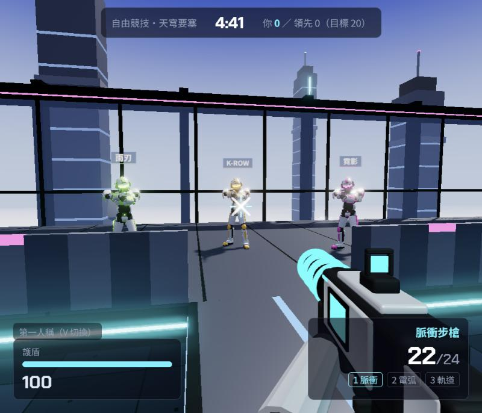
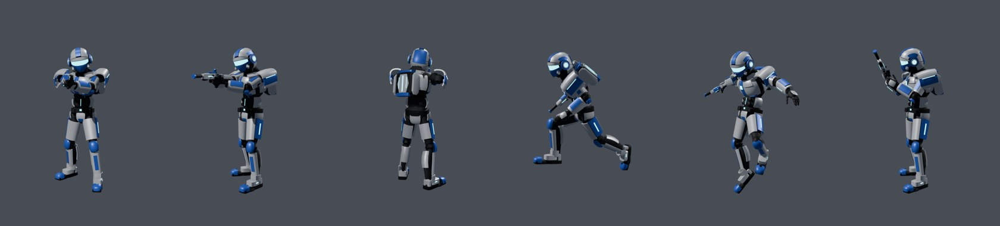
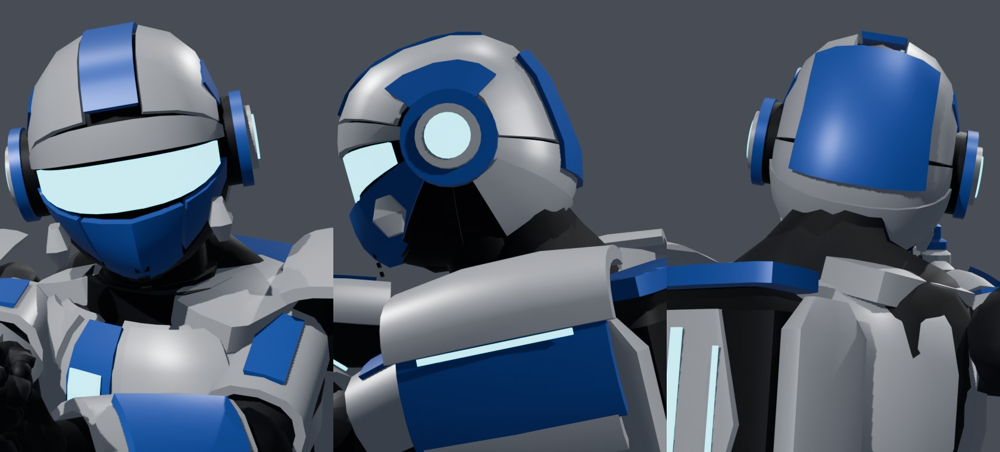
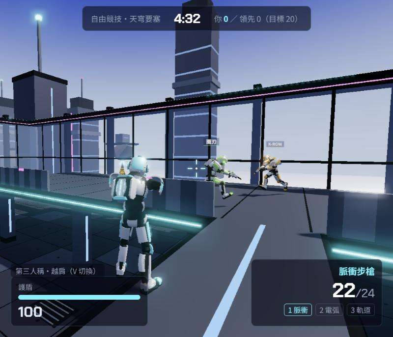
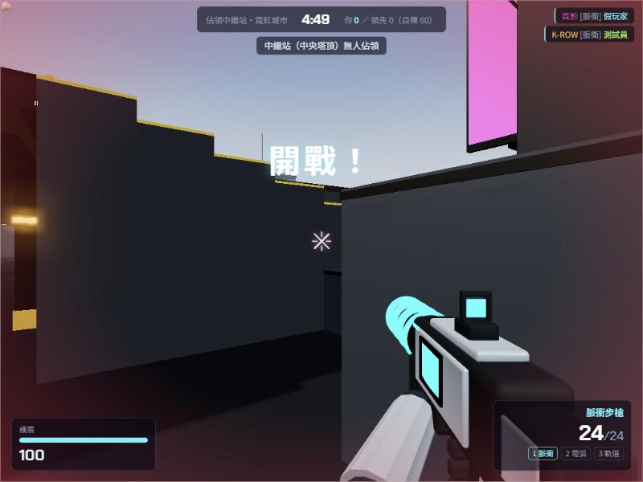
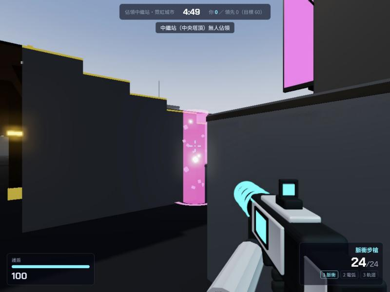

# NEON GRID TPC

這是 NEON GRID 的第一人稱射擊新版，可以單人對戰機器人，也可以連線對戰（Cloudflare Workers）。移動與相機改用 [three-player-controller](https://github.com/hh-hang/three-player-controller)（MIT）。地圖、武器、道具和遊戲規則都沿用原版（`Downloads\neon-grid-online_2\neon-grid-online`）；角色改用新做的機甲（見下方「角色」）。原版沒有被改動，這裡只複製了它的模型、`shared.js` 和 `bot.js`。



上傳到 GitHub、用 GitHub Pages 架成網頁遊戲的步驟，見 [GITHUB.md](GITHUB.md)。連線版的架構與部署見下方「連線對戰」。

## 執行方式

不需要 Node.js，也不需要建置。三個函式庫都已經放在 `vendor/`，透過 import map 直接以 ESM 載入：three r169、three-mesh-bvh 0.8.3、three-player-controller 0.6.3。

```bash
python serve.py
```

然後開 `http://localhost:8800/`。也可以加上埠號參數，例如 `python serve.py 9000`。

這樣只能玩單人；連線對戰要用 Cloudflare 的 `wrangler dev`（見「連線對戰」）。不想裝 Node 時，網址加 `?loop`，伺服器核心會直接在這個分頁裡跑，可以一個人測連線流程。

- 一定要經過伺服器開啟，不能直接雙擊 `index.html`：瀏覽器不允許 `file://` 載入 ES module 和 glb。
- `serve.py` 會送出 no-store 標頭，所以改完檔案重新整理就能看到新版。它也明確設定了 `.js`／`.mjs` 的 MIME：Windows 有時把 `.js` 登記成 text/plain，ES module 會因此載不進來。
- 手機測試：電腦和手機連同一個 Wi-Fi，用手機開 `http://<電腦 IP>:8800/`。手機會自動讀 `_low` 模型，並顯示觸控按鈕。
- 網址加 `?test` 是自動化測試模式：沒有滑鼠鎖定也不會暫停，而且可以用 `__NG.tick(n)` 手動推進、用 `__NG.snap()` 截取 WebGL 畫面。
- 網址加 `?loop=sync`（搭配 `?test`）時，迴路伺服器不自己計時，而是跟著 `__NG.tick` 推進，自動化測試不受面板隱藏影響。

## 操作

| 動作 | 電腦 | 手機 |
| --- | --- | --- |
| 移動／跳 | WASD／空白鍵 | 左下虛擬搖桿／JUMP（套件內建） |
| 瞄準 | 滑鼠（點畫面鎖定游標） | 右半邊拖曳；按住 FIRE 時也能拖曳 |
| 射擊 | 左鍵（按住連發） | 按住 FIRE |
| 換彈 | R | R |
| 換槍 | 1／2／3、Q、滾輪 | ⇄ |
| 計分板／暫停 | Tab／Esc | II |

## 選單

- 地圖：五張地圖任選一張（霓虹城市、地下電網、天穹要塞、熔岩工業區、海岸研究站），或選「隨機」。隨機不會連續抽到同一張。
- 模式：自由競技（先拿 20 次淘汰），或佔領中繼站（獨自站在中央塔頂每秒得 1 分，先到 60 分）。
- 難度：簡單、普通、困難，數值沿用原版的 `DIFF`。
- 機器人數量：按鈕只寫數字（1、2、3、5、7）。
- 連線對戰：輸入暱稱後按「連線對戰」。地圖、模式和機器人數量由伺服器決定。

## 架構

| 檔案 | 內容 |
| --- | --- |
| `index.html` | import map、選單和 HUD 的 DOM |
| `src/main.js` | 開機、選單、對戰流程、主迴圈、輸入、泛光後製 |
| `src/player.js` | 本機玩家：包裝 three-player-controller，加上射擊、換彈、換槍、第一人稱槍模、上半身動作疊加 |
| `src/match.js` | 單人版規則核心：從原版 `core.js` 的 GameCore 搬來，拿掉連線、排隊和延遲補償 |
| `src/netcore.js` | 連線版房間核心（伺服器裁判），Durable Object 和 `?loop` 都跑它 |
| `src/net.js` | 連線版瀏覽器端：回報自己的位置、內插其他玩家、處理伺服器事件；也有 `?loop` 用的迴路伺服器 |
| `server/worker.js`、`wrangler.toml` | Cloudflare Worker 入口和 Durable Object 房間 |
| `src/arena.js` | 載入地圖 glb，設定各地圖的霧、燈光和天空，挑出碰撞網格，顯示道具和中繼站 |
| `src/assets.js` | 模型載入（手機讀 `_low`）、材質規則（TeamColor、Glow）、角色設定檔 `CHARS`、招牌文字、名牌 |
| `src/fx.js` | 彈道光束、火光、命中火花、戰敗消失特效、WebAudio 合成音效 |
| `src/hud.js` | HUD、擊殺訊息、計分板、結算 |
| `src/shared.js`、`src/bot.js` | 從原版原封不動複製 |
| `blender/` | 角色機甲的生成腳本與來源檔（見下方「角色」） |

### 怎麼借用套件的架構

- 玩家：移動、重力、跳躍、膠囊碰撞（BVH）、上下樓梯、第一人稱相機、手機搖桿，都交給套件處理。
  - 遊戲只有第一人稱：`isFirstPerson: true`，鍵盤的 `toggleView` 設成 null（V 鍵無效），手機的 VIEW 鍵也關掉（`mobileControls.view: false`）。
  - 套件的基準單位是公分，所以用 `scale: 0.01`。
  - 速度 6 m/s、重力 22、起跳速度 6.8 m/s，都換算自原版的 `P`。
- 角色：`agent.glb` 直接交給套件。Idle 對應 idle，Run 對應 walk 和 run，Jump 對應 jump。
  - Fire 和 Reload 只有上半身的關鍵影格，所以直接疊在套件的 AnimationMixer 上，權重 4，做法跟原版一樣。套件的 `playAnimation` 會把下半身動作整個換掉，所以沒有用它。
  - 機器人的瞄準俯仰角加在脊椎骨上。
- 地圖碰撞：地圖 glb 直接拿來建 BVH，但只用「名稱出現在 `shared.js buildMap()` 第 9 欄的物件」加上 `Ground`。
  - 原版的碰撞唯一來源是 buildMap，glb 也是照它建的。
  - `*_Decor`、`Detail_Fine_Decor`、`Sign_*`、`Backdrop_*` 這些裝飾和遠景只看不碰。
  - 五張地圖的碰撞物件都對得上，沒有缺漏。在 29×29 的網格上往下打射線，比較 glb 網格和 buildMap 方塊的高度：差異只出現在圓管、尖塔這類圓形物件（原版本來就只比外框），還有一個網格點剛好落在薄防爆板的邊緣。
- 機器人：用原版的 `bot.js` 和 `shared.js` 方塊物理，以固定 60 Hz 跑，跟原版伺服器一樣。命中判定也用 buildMap 方塊，所以玩家（BVH）和機器人（方塊）踩的是同一組幾何。
- 射擊：準心射線從鏡頭穿過畫面中央找出瞄準點，再從角色眼睛朝瞄準點開槍。電弧的 8 束仍是原版 `PATTERN` 的固定圖形。

## 角色：UAL 骨架機甲（`models/mech.glb`）





身體用的是 three-player-controller footIK 範例裡的人物：Quaternius 的 Universal Animation Library（UAL）Mannequin，作為黑色作戰服。外面套上依「角色機甲設計」做的硬殼裝甲：白色護甲、藍色 TeamColor 甲板、青色 TeamGlow 護目鏡與燈條、黑色作戰服和暗色金屬。

**來源與授權**
- `blender/src/ual.glb` 是套件 repo 裡 `example/public/glb/ual.glb` 的原檔。repo 本身沒有寫模型的出處或授權。
  - 這個檔案**不進 git**（列在 `.gitignore`），因為裡面的 fly* 動作授權不明。要重建角色時，從 `https://raw.githubusercontent.com/hh-hang/three-player-controller/master/example/public/glb/ual.glb` 下載，放到 `blender/src/ual.glb`。
  - 遊戲用的 `models/mech.glb` 已經拿掉 fly* 動作，可以正常上傳。
- 這個檔案的 Mannequin、M_Main／M_Joints 材質和動作名稱，都跟 Quaternius 的 [Universal Animation Library](https://quaternius.com/packs/universalanimationlibrary.html) 一致。官方 [itch.io 頁面](https://quaternius.itch.io/universal-animation-library) 標示授權為 **CC0**，免費的 Standard 版有 45 個動作。
- ual.glb 有 53 個動作：扣掉 8 個小寫 `fly*` 開頭的動作，剩下剛好 45 個。所以判定這是 UAL Standard，`fly*` 是套件作者另外加的。那 8 個動作的授權不明，**不使用、也不匯出**。
- glb 的 asset 資訊裡只有 Blender 匯出器版本，沒有作者欄位。上面的判定是依據名稱和數量比對，沒有跟官方下載檔逐位元組比對過。官方檔要經過 itch.io 的下載流程才拿得到，這裡沒有下載。

**生成方式**（Blender 5.2，背景執行）

```bash
"C:\Program Files\Blender Foundation\Blender 5.2\blender.exe" -b --factory-startup --python blender/run_gen_mech.py -- --q both --tag v2
```

- 會輸出 `blender/out/mech.glb`、`mech_low.glb` 和預覽圖。要把兩個 glb 複製到 `models/`，遊戲才會用到新版。
- `blender/gen_mech_ual.py` 匯入 ual.glb 後，刪掉一顆多餘的 2 m Icosphere，只保留遊戲用到的 13 個動作。裝甲用原版 `C:\esp\blender_weapons\gen_agent.py` 的曲面殼工具（sq、tube、rbox、cyl、PartMesh），依 UAL 的骨頭位置重新排版。
- 每片裝甲 100% 綁一根骨頭。肩甲綁在 clavicle 上，舉槍時會跟著聳肩。
- 槍是一把短卡賓槍，併在裝甲網格裡、綁 `hand_r`。擺放方式：先在 Pistol_Idle_Loop 姿勢下把槍放成槍口朝正前方，再換算回 T-pose。`Muzzle` 節點掛在 `hand_r` 底下。
- 材質名稱沿用規格：TeamColor、TeamGlow、DarkMetal、ArmorLight；作戰服是新加的 Suit。遊戲會依玩家代表色替 TeamColor／TeamGlow 換色。
- 面數：

  | 版本 | Mannequin | 裝甲＋槍 | 檔案大小 |
  | --- | --- | --- | --- |
  | 電腦版 | 13.7k 三角面 | 12.3k 三角面 | 1.9 MB |
  | 手機版 | 4.4k（Decimate 0.32） | 4.2k | 1.3 MB |

- 沒有烘焙法線和 AO 貼圖，全部是單色材質。原版 agent.glb 有烘焙。
- 檢查過的姿勢：持槍待機、跑步、跳躍、換彈和 T-pose，都有輸出預覽圖。裝甲穿模的地方已經修過：大腿前甲和背甲加大，補上斜方肌甲。
  - 每個動作只抽一幀看，沒有逐幀檢查。硬殼綁單一骨頭，動作幅度大時（跑步的大腿和腰側甲）仍可能有輕微交疊。

**跟原版 agent.glb 規格的差異**
- **骨架不同：** UAL 是 65 根骨頭（含手指；骨頭名稱像 pelvis、spine_01～03、neck_01、Head、clavicle_*、upperarm_*、thigh_*、calf_*、foot_*、ball_*）。原版規格是 17 根（Hips、Spine、Chest…）。這版不需要沿用原版骨架，所以兩者不相容：原版的 Idle／Run／Jump／Fire／Reload 不能直接套在新骨架上，反過來也一樣。
- **身高：** 約 1.86 m（含頭盔）。命中判定仍用原版的 0.76×0.76×1.86 方柱。
- **動作對應：**

  | 遊戲用途 | UAL 動作 |
  | --- | --- |
  | 待機 | Pistol_Idle_Loop |
  | 移動 | Jog_Fwd_Loop |
  | 跳躍 | 三段式 Jump_Start → Jump_Loop → Jump_Land（套件的 jumpAnim 陣列）；機器人在空中播 Jump_Loop |
  | 射擊 | Pistol_Shoot |
  | 換彈 | Pistol_Reload（縮放到該武器的換彈秒數） |

  - 上半身一直疊著 Pistol_Idle_Loop，所以跑步、跳躍時也維持持槍姿勢。
  - 射擊和換彈只取 spine_03 以下（含手臂、頭）的軌道，用較高的權重疊上去，不會動到腿。
  - 瞄準俯仰加在 spine_02、spine_03、neck_01 上。
  - UAL Standard 沒有左右平移和後退的動作，所以全部用 Jog。
- **第一人稱：** 相機改掛在套件的膠囊上（眼睛高 1.62 m），不再掛頭骨，跑步時畫面不會跟著動畫晃。
- **退回原版角色：** `models/mech.glb` 讀不到時，會自動改用原版 `agent.glb`。兩種角色都寫在 `src/assets.js` 的 `CHARS` 設定檔裡。

## 連線對戰（Cloudflare Workers）




### 架構：玩家回報位置＋伺服器裁判

three-player-controller 的移動和碰撞都在瀏覽器裡計算，做不到原版那種「伺服器算所有人移動」。所以改成這樣分工：

| 誰負責 | 內容 |
| --- | --- |
| 各自的瀏覽器 | 自己的移動、跳躍、碰撞（套件 BVH）。每 50 ms 回報位置、速度、朝向給伺服器 |
| 伺服器（一個 Durable Object） | 檢查回報的位置合不合理；開槍時用伺服器自己的計時檢查射速、彈藥、換彈、換槍；用原版 `shared.js` 的方塊資料算射線、牆壁遮擋、距離傷害，並做延遲補償（目標退回最多 0.3 秒前的位置）；傷害、擊殺、計分、重生、道具、佔領中繼站、比賽流程（倒數 → 5 分鐘 → 結算 10 秒 → 下一場，模式輪替、每場隨機地圖不連續重複）；機器人照原版在伺服器上用方塊物理跑，房間不足 4 人時補機器人，真人進來就讓位 |
| 其他玩家的畫面 | 用伺服器每秒 20 次的快照，在 0.1 秒前的兩筆之間內插 |

**防作弊做了什麼、沒做什麼**

- 有做：
  - 一次移動太遠、離開場地範圍、往上跳太高，伺服器都不採用，並把玩家退回伺服器記錄的位置。
  - 射速、彈藥、換彈時間由伺服器計時；彈道和傷害由伺服器算。
  - 每秒訊息數量有上限；暱稱會過濾。
- 沒做：
  - 不檢查穿牆或飛天：伺服器不跑玩家的物理，只看移動速度。
  - 修改過的瀏覽器可以送出「沒有後座力、自動瞄準」的開槍方向。
- 結論：適合朋友之間玩，不適合公開排名賽。

### 本機測試

**不裝 Node**：開 `http://localhost:8800/?loop`，輸入暱稱，按「連線對戰」。伺服器核心直接在這個分頁裡跑，會補 3 隻機器人。這樣只能自己一個人測。

**裝 Node，跑真正的 Cloudflare 環境：**

1. 到 <https://nodejs.org> 下載 **LTS 版**安裝（這台電腦目前沒有 Node）。
2. 在專案資料夾（`C:\esp\neon-grid-tpc`）打開 PowerShell 或 Git Bash，安裝 wrangler：

   ```bash
   npm install
   ```

3. 啟動本機的 Worker：

   ```bash
   npx wrangler dev
   ```

4. 開 `http://localhost:8787/`，按「連線對戰」。同一個 Wi-Fi 的手機或其他電腦要一起玩時，改用這個指令：

   ```bash
   npx wrangler dev --ip 0.0.0.0
   ```

   然後用 `http://<電腦 IP>:8787/` 開。

### 部署到 Cloudflare（你自己操作）

1. 登入 Cloudflare。會開瀏覽器請你授權，用你原本放 NEON GRID 的帳號就可以：

   ```bash
   npx wrangler login
   ```

2. 部署：

   ```bash
   npx wrangler deploy
   ```

3. 完成後會印出網址，例如 `https://neon-grid-tpc.<你的子網域>.workers.dev`。把這個網址傳給朋友，按「連線對戰」就會進同一個房間。

部署設定的細節：

- 遊戲網頁也由同一個 Worker 提供。部署前 `wrangler.toml` 的 `[build]` 會自動執行 `scripts/build-assets.mjs`，只把 `index.html`、`src/`、`vendor/`、`models/` 複製到 `dist/`，Cloudflare 只上傳 `dist/`（約 68 個檔案）。`node_modules` 裡有 129 MB 的檔案，超過 Workers 單檔 25 MB 上限，所以不能把整個專案資料夾當靜態資源。
- 要在專案資料夾裡執行 `npx wrangler dev`／`deploy`：建置指令用的是相對路徑。
- Durable Object 用 SQLite 型，免費方案就能用（跟原版相同）。
- 只有一個房間（`idFromName('main')`），最多 8 個真人。
- 前端和伺服器要用同一版程式。改了 `src/` 就重新 `npx wrangler deploy`；`NET_VERSION` 不同時，瀏覽器會提示重新整理。
- 網頁放在別處（例如 GitHub Pages）時，網址加 `?server=wss://neon-grid-tpc.<你的子網域>.workers.dev/ws` 也能連到這個 Worker。

### 驗證範圍

在 Claude 的瀏覽器裡用迴路模式（`?loop=sync`，同一套 `netcore.js`）測過：

- 連線進房、補機器人、倒數、開戰。
- 回報的位置同步到伺服器；瞬移會被擋下並退回原位。
- 其他玩家的動作內插正常。
- 另外接了一個假的第二位真人：互相射擊命中、各扣 20、擊殺計分、擊殺訊息、死亡畫面顯示擊殺者、重生後位置同步。
- 結算畫面出現，之後自動換地圖（熔岩工業區 → 霓虹城市）並換到佔領中繼站模式。

**沒有驗證的部分**：

- `server/worker.js` 只寫好、沒有實際跑過。這台電腦沒有 Node，所以沒能用 `wrangler dev` 或部署測試。它是照原版 `src/worker.js` 的寫法改的。
- 兩台實體裝置之間的真實網路延遲，也還沒測過。

## 規則（全部直接呼叫原版 `shared.js`）

- 護盾 100，陣亡後 3 秒重生，重生保護 1.5 秒（開槍就解除）。重生點用 `pickSpawn`，會避開敵人視線。
- 武器用 `WEAPONS` 和 `dmgAt`。在遊戲內實測的傷害：

  | 距離 | 5 m | 12 m | 20 m | 30 m |
  | --- | --- | --- | --- | --- |
  | 脈衝 | 20 | 20 | 19 | 16.7 |
  | 電弧（8 束合計） | 84.8 | 26 | 2.8 | 0（超過射程 22 m） |
  | 軌道 | 90 | 90 | 90 | 90 |

  - 脈衝步槍：15 m 外開始遞減，60 m 剩一半。
  - 電弧散射器：8 束、每束 11，越遠命中的束數和每束傷害都會下降。
  - 軌道狙擊槍：90，遠近傷害相同，彈匣 3 發，換彈 3.2 秒。
- 道具：護盾 +50（20 秒後重生），加速 ×1.35 持續 6 秒（25 秒後重生），位置用 `PICKUPS`。
- 對戰：倒數 3 秒，比賽 5 分鐘。時間到或有人達到目標分數就結算。

## 跟原版的差異

- **連線版不是伺服器權威移動。** 原版由伺服器跑所有人的 `shared.js` 物理；這版真人玩家的移動在各自瀏覽器裡算（套件的 BVH），伺服器只檢查位置合不合理。命中、傷害、計分仍由伺服器判定，詳見「連線對戰」。另外沒有排隊、快速聊天和排行榜。
- **只有第一人稱。** 套件的第三人稱與視角切換都關掉了；其他玩家仍顯示成完整的機甲角色。
- **戰敗時有消失特效**：倒下的位置會爆出代表色碎片、白色閃光、光柱和地面擴散環，然後角色消失。
- **移動手感不同。** 原版玩家用 `shared.js` 的方塊物理；這版玩家用套件的膠囊加 BVH。
  - 這版的加減速比較平滑，上台階是靠膠囊懸浮高度（0.4 m）自動跨上去。
  - 速度、重力和跳躍高度都換算自原版數值，但空中控制和貼牆滑動的感覺會不一樣。
- **角色換成 UAL 骨架的新機甲**（見上方「角色」），骨架和動作跟原版 agent.glb 不相容。
- **其他玩家（機器人）手上看到的是同一把短卡賓槍**，換槍時不會換模型。自己的第一人稱仍然用三把 `gun_*.glb` 槍模。
- **畫面簡化了：**
  - 沒有原版城市地圖背景的程式產生大樓、雨、纜線、中繼塔光束、資料核心和各地圖的點光源，牆面材質也直接用 glb 的。
  - 泛光只在電腦版開啟。燈光已改用 r155 之後的物理單位，所以強度換算過，跟原版不會完全一樣。
- **沒有設定頁。** 靈敏度、音量、畫質都用預設值，只有選單裡的選項會記在 localStorage。
- **手機上的鏡頭轉動**由套件的觸控視角負責；原版有自訂的加速度曲線。

## 授權

- `vendor/three`、`vendor/three-mesh-bvh`、`vendor/three-player-controller` 都是 MIT 授權，各自的 LICENSE 檔在同一個資料夾裡。
- 角色身體和動作：Quaternius Universal Animation Library（CC0），檔案取自 three-player-controller 範例。
- 地圖、武器、道具模型和規則程式來自原版 NEON GRID；角色裝甲由 `blender/gen_mech_ual.py` 生成。
